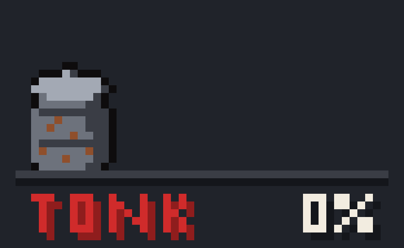
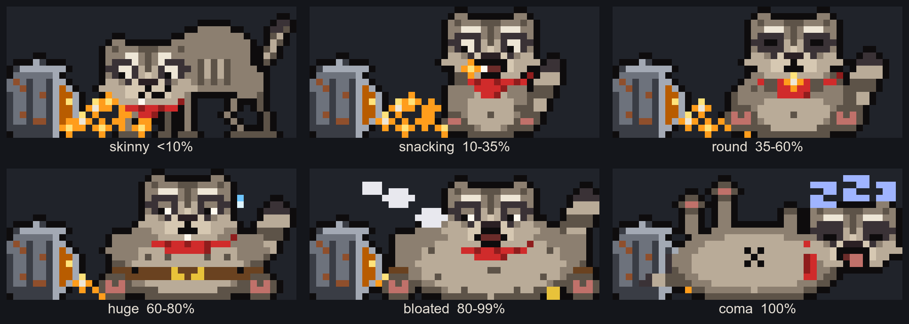
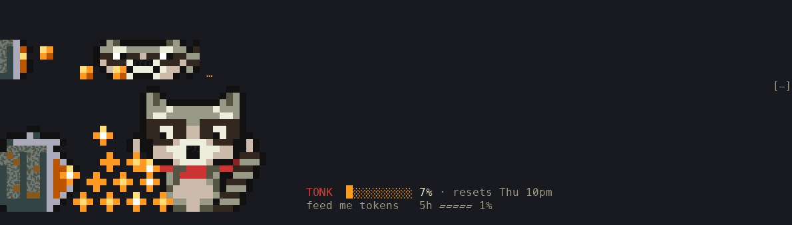

# Tonk





Tonk is a pixel-art punk raccoon who lives above your Claude Code prompt and eats your usage. The more of your weekly limit you burn, the fatter he gets. At 100% he's in a food coma. When the week resets he does jumping jacks and starts skinny again.

It's a Claude Code mod (a plugin of function hooks). No extra processes, no network, nothing written outside the mod's own small store.

## How he eats

- **Spinner chomp.** While Claude works, the spinner is replaced by a tiny Tonk chomping pellets from a trash-can feeder, next to the usual spinner word.
- **Pellet bursts.** When a reply finishes, pellets fall into the band and he gobbles them. How many depends on what the reply cost: 1 pellet per 2,000 tokens (input + output + cache writes; cache reads don't count), max 12. If a turn reports no token data, it falls back to the 5-hour usage change, then the weekly usage change (1 pellet per half a percentage point), then a 1-pellet snack.
- **Belly tied to weekly usage.** Weekly percent picks his body: skinny (<10), snacking (10-35), round (35-60), huge (60-80), bloated (80-99), food coma (100). With no usage reading yet he's asleep ("no snacks yet").
- **Stick poke when idle.** No turns for about 2 minutes and he pokes the can with a stick. At 5 minutes it gets frantic. At 10 minutes he bangs on the can. Any new turn resets the timer. A food coma overrides all of it; he's asleep.
- **Can intro.** When a session starts, and again right after the reset workout ends, Tonk knocks an upright trash can over and the pellets spill (about 2.6 seconds, caption "oops. dinner is served."). It plays once, not on every redraw or turn. If you send a prompt mid-intro it is skipped and the spinner chomp takes over. In a food coma he's asleep, so no intro: he sits beside the drained can.
- **Belly jiggle.** When a pellet burst lands, his belly jiggles for half a second.
- **Idle micro-animations.** While he rests he blinks every 3-6 seconds, and now and then swishes his tail or twitches an ear. The timing is pseudo-random but fully determined by the clock, so it is the same every run (and testable). The band redraws at most 8 times a second.
- **Random delight events.** Roughly every 45-120 seconds of idle he does something: washes a pellet, finds treasure in the can, wears the lid as a hat, juggles, sneezes, looks up, or dozes. Common ones (look up, wash, sneeze, doze) show up more; a golden snack is about 1 in 50 (caption "✨ golden snack!"); the bandana cape only appears in October. The same event never plays twice in a row. Nothing plays during a turn, intro, burst or food coma, and the stick pokes take over once he's been idle 2+ minutes. The sequence is seeded from the session and start time.
- **Missing art is fine.** Every one of these falls back to the plain frames if the art for it isn't there; nothing crashes.
- **Reset workout.** When the weekly percent drops sharply, he does jumping jacks for 6 seconds.

## Install

Needs Claude Code 2.1.287 or newer (the `ui.render` mod hooks).

```bash
git clone https://github.com/treynortetik-creator/tonk.git ~/tonk
claude --plugin-dir ~/tonk     # this session only, installs nothing
```

A marketplace install is coming.

## Try it

`--plugin-dir` loads a plugin for that one session and installs nothing. To also keep your real config out of it, point the session at an empty config directory. You'll have to log in once inside it, and it carries none of your plugins (so none of your channels or MCP servers):

```bash
CLAUDE_CONFIG_DIR="$(mktemp -d)" claude --plugin-dir ~/tonk
```

Delete the temp directory when done. To try it against your normal config without installing, drop the `CLAUDE_CONFIG_DIR=` part.



Checks you can run any time:

```bash
claude plugin validate .
claude plugin test .          # mounted-UI and logic tests
tsc -p .                      # type check
bash tests/statusline.test.sh # status-line script
node scripts/preview.ts       # regenerate previews/*.png
```

## Status-line fallback

For terminals or surfaces where the pixel band can't draw, `statusline/tonk-statusline.sh` prints a 2-line emoji Tonk: a face for his state, a bar, the weekly percent, the reset time, and the 5-hour meter. Needs `jq`.

```
😬 TONK  ███████░░░ 68%  resets Thu 4pm
   belt's holding. barely.   ·   5h ▰▱▱▱▱ 23%
```

Add it to `~/.claude/settings.json` yourself (the mod never edits your settings):

```json
{
  "statusLine": {
    "type": "command",
    "command": "~/tonk/statusline/tonk-statusline.sh"
  }
}
```

It reads `.rate_limits.seven_day.used_percentage`, `.rate_limits.seven_day.resets_at` and `.rate_limits.five_hour.used_percentage`. Missing data prints a sleeping Tonk instead of an error.

## Caveats

- Rate-limit data exists only on claude.ai Pro/Max logins, and only after the first API response of a session. Before that (or on API-key billing) Tonk sleeps.
- He draws only in the terminal UI: no VS Code panel, and nothing in `-p` / print mode. Narrow terminals (under 46 columns) get a one-line text version.
- Replacing the spinner drops the engine's elapsed-time / token / effort text on that row. The spinner word stays.

## License

MIT. See `LICENSE`.
